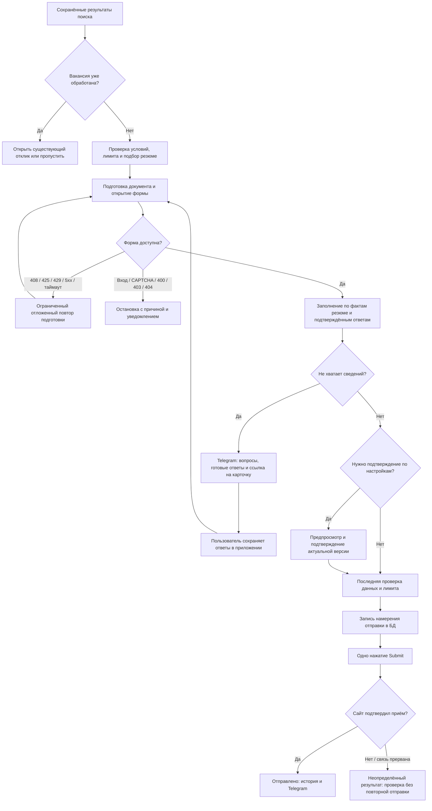

# Алгоритм автоматических откликов

Поиск сохраняет вакансии. Исполнитель откликов берёт только подходящие вакансии, для которых разрешена автоматизация, проверяет историю и подбирает загруженное резюме. Совпадение по URL или компании и должности не создаёт второй отклик, даже если источник или местоположение отличаются.

## Ответы на вопросы

Карточка отклика показывает обнаруженные вопросы и варианты выбора. Можно сохранить несколько ответов сразу, сохранить часть без продолжения или продолжить подготовку. По умолчанию ответ относится к этой заявке. Для использования в будущих заявках есть отдельная отметка у каждого ответа.

Перед сохранением сервер проверяет актуальность формы и попытки. Нельзя сохранить ответ на чужой вопрос, выбрать несуществующий вариант или изменить ответы после начала отправки. Изменение ответов сбрасывает предыдущее разрешение на отправку. Сам текст вакансии не считается сведениями о кандидате.

## Ошибки и уведомления

- Для временных сбоев разрешены два повторных запуска подготовки. Паузы — не менее 15 и 45 секунд; при 429 — не менее минуты. Учитывается `Retry-After` в секундах или в виде даты; чрезмерные значения ограничены семью днями.
- При неверном запросе, закрытой вакансии, входе или защитной проверке автоматическая цепочка останавливается. Уже подготовленные ответы остаются доступны. Вход в отдельном браузере пользователя не переносит cookies в браузер исполнителя.
- Если отправка могла уйти работодателю, повторный Submit запрещён. Отсутствие подтверждения не считается успешным откликом.
- Telegram получает сведения о вакансии, выбранном резюме и результате. При подтверждении или остановке доступны готовые ответы и обнаруженные вопросы; ссылка ведёт в защищённую карточку отклика. Контактные поля в перечень вопросов не входят.

## Нагрузка и расходы

Сохранены существующий сервис Render, база и очередь уведомлений. Платные сервисы и новая инфраструктура не добавлены. История и настройки автоматизации остаются в прежних таблицах; миграция схемы для обновления не нужна.

Исполнитель в простое опрашивает очередь раз в 30 секунд, активную работу — раз в две секунды. Команды из приложения будят его сразу после записи в базу. Дубликаты отбрасываются до чтения файлов резюме. Очередь подготовки учитывается при расчёте доступного дневного бюджета.

Для общих вопросов используются локальные правила и подтверждённые факты. Повторяющиеся вопросы кэшируются в пределах подготовки, включая вопросы без подходящего ответа. Для остальных установлен предел в шесть запросов к модели на подготовку; его можно изменить через `LLM_QUESTION_LIMIT`. Публичные ресурсы формы не вызывают чтение настроек из базы на каждый запрос; навигация и запись по-прежнему проверяют действующие разрешения. Видео и внешние шрифты не загружаются.

Закрытая история откликов не запрашивает данные. Открытая загружает краткий список одним соединённым запросом раз в 30 секунд. Подробности конкретной заявки запрашиваются при открытии.

Исполнитель работает, пока запущен API. При засыпании бесплатного Render обработка возобновится после пробуждения и восстановления очереди. Обновление не превращает бесплатный спящий сервис в круглосуточный исполнитель. Фактическая экономия зависит от числа вакансий, сложности форм и выбранной модели; фиксированный процент снижения счёта не заявляется.
